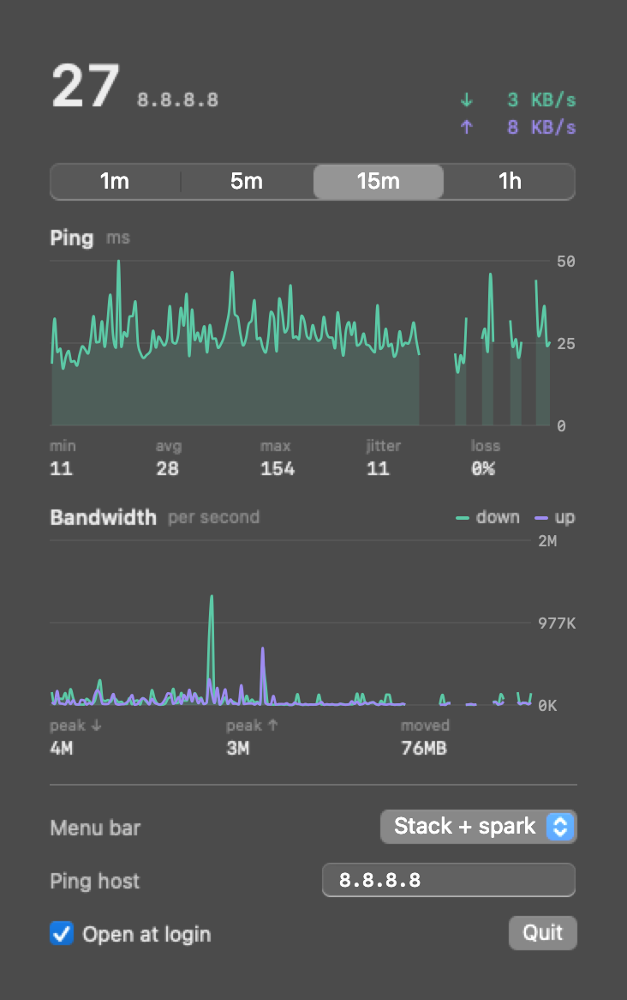

# Pulsebar

A minimal macOS menu bar monitor for network bandwidth and ping. It stays a fixed width, so the
menu bar never shifts as the numbers change.

<picture>
  <source media="(prefers-color-scheme: dark)" srcset="docs/menubar-dark.png">
  
</picture>



## Install

```bash
brew install --cask skyvis-my/tap/pulsebar
```

Or download `Pulsebar-<version>.zip` from [Releases](https://github.com/skyvis-my/pulsebar/releases),
unzip, and move `Pulsebar.app` to `/Applications`.

Pulsebar is ad-hoc signed, not notarized by Apple. The Homebrew cask clears the download
quarantine flag for you. If you install from the zip, macOS will block the first launch: right-click
the app, choose **Open**, then confirm (or run `xattr -dr com.apple.quarantine /Applications/Pulsebar.app`).

Requires macOS 14 or later, on Apple silicon or Intel.

## Menu bar styles

Every style has a fixed width: numbers are monospaced and padded to a fixed length, and the
status item width is computed once from worst-case strings. Pick a style in the popover.

| Style | Shows | Width |
|---|---|---|
| Twin stack | ↑/↓ speeds, ping | 52 pt |
| Stack + spark (default) | Same layout, with faint bandwidth history behind the speeds and ping history behind the ping | 52 pt |
| Single line | `↓ 98M ↑  1M 214` | 93 pt |
| Ping only | last 6 pings as latency bars, ping | 41 pt |

Speeds are bytes per second with a one-letter unit (`K`, `M`, `G`), always whole numbers: the unit
steps up at 1000, so three digits always fit. Ping is always in milliseconds, so the menu bar shows
no unit. A red `–` means the probe timed out.

## Popover

Click the item for ping and bandwidth history graphs (1m / 5m / 15m / 1h), with min / avg / max /
jitter / loss for ping and peak / total moved for bandwidth. You can also change the menu bar
style, the ping host, and open at login there. The last hour of samples is saved to
`~/Library/Application Support/Pulsebar/history.json` and reloaded on launch.

## Backpack mode: lid closed, screen off, still running

If sleep is disabled on your Mac (`sudo pmset -a disablesleep 1`, or a keep-awake app that sets it),
closing the lid keeps macOS and the network running, but the built-in screen stays lit. With
**Screen off when lid closes** on (the default), Pulsebar turns the display off about 2 seconds
after the lid closes. It does nothing while an external monitor is awake, so lid-closed desk setups
are unaffected. The popover shows whether sleep is currently disabled. No admin rights are needed.

Pulsebar doesn't change your sleep setting. A closed bag blocks airflow, so keep heavy workloads
out of the backpack.

## How it measures

- **Bandwidth**: 64-bit interface counters from `sysctl(NET_RT_IFLIST2)`, summed over physical
  interfaces (`en*`, `pdp_ip*`). VPN tunnels are skipped to avoid counting traffic twice.
- **Ping**: unprivileged ICMP echo (`SOCK_DGRAM` / `IPPROTO_ICMP`) once a second, 0.9 s timeout.
  No root and no `ping` subprocess. The default host is `1.1.1.1`.

Pulsebar makes no network requests other than the ping, and collects no data.

## Build from source

```bash
./scripts/build-app.sh && open build/Pulsebar.app
```

Needs Xcode 16 or later. `swift test` checks the fixed-width formatting.
`Pulsebar --snapshot <dir>` renders every style and the popover to PNGs (used for the screenshots
above), then quits. `Pulsebar --open-at-login` / `--no-open-at-login` toggle the login item from
the command line.

## Releasing

```bash
./scripts/release.sh 0.2.0
```

Builds a universal app, publishes a GitHub release with the zip, and bumps the cask in
[skyvis-my/homebrew-tap](https://github.com/skyvis-my/homebrew-tap).

## License

[MIT](LICENSE)
